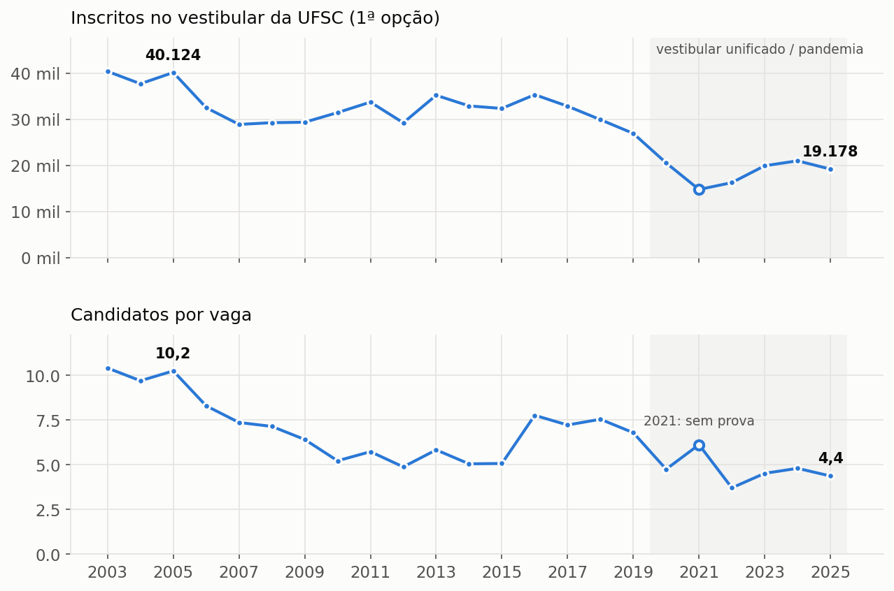
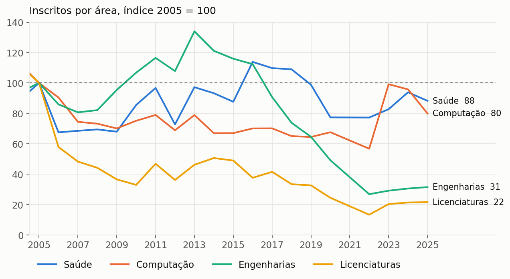
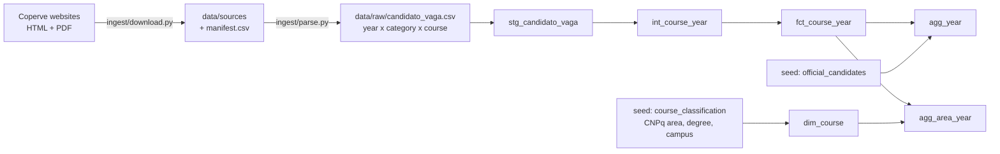

# 🎓 UFSC Entrance Exam, 2003–2025

[](https://github.com/RodrigoJacquesW/UFSC_data_analysis/actions/workflows/dbt.yml)

How many people apply to the entrance exam (*vestibular*) of the Federal University of Santa Catarina (UFSC), and for which courses? This project rebuilds 23 years of official data, published every year in a different format (HTML pages, PDF tables, one PDF per quota category), into one consistent and tested series.

Stack: **Python** (download + PDF/HTML parsing) → **dbt + DuckDB** (modeling and tests, runs locally with no cloud account) → **GitHub Actions** (runs `dbt build` on every push).



## Findings

- **Applicants fell 52%:** from 40,124 in 2005 to 19,178 in 2025. In the same period the number of vacancies offered in the exam grew 12% (3,920 → 4,391), so competition fell from **10.2 to 4.4 applicants per vacancy**.
- **Engineering lost 77% of its applicants** after peaking in 2013 (8,178 → 1,919). Civil Engineering went from 2,058 to 243 (−88%).
- **Teaching degrees (*licenciaturas*) fell 78%** (2,614 in 2005 → 563).
- **Health is the most resilient area** (−22% from its 2016 peak), and **computing recovered**: Computer Science went from 521 applicants in 2013 to 757 in 2025.



**What this data does and does not say.** It counts applicants to UFSC's *own* exam. Part of UFSC's vacancies are also offered through SiSU (the national ENEM-based system) and are not in these files. The fall in exam applicants is therefore *not* the same as a fall in demand for the university. It is the combination of fewer exam applicants and a shift to other ways in. The exam itself also changed: unified with UFFS in 2020 and with IFSC/IFC from 2023, and no exam at all in 2021 (pandemic).

## How the series was rebuilt

Coperve publishes one "relação candidato/vaga" (applicants per vacancy) per year, and the layout changes over time:

| Years | Source format | What it contains |
|---|---|---|
| 2003–2007 | HTML table | vacancies and 1st-option applicants per course |
| 2008–2010 | HTML table | total + affirmative-action (PAA) groups |
| 2011–2012 | PDF, one table | total, non-PAA and PAA groups |
| 2013–2019 | one PDF per quota category | "Classificação Geral" + one file per PAA category |
| 2020–2025 | one PDF per category + a "Total" file | from 2020, UFSC and other institutions in the same files |

Five decisions make the years comparable. Each one was checked against the data:

1. **Applicants in 2013–2019 come from "Classificação Geral".** That file lists *all* candidates of a course, but only the general-list vacancies. Where both files exist (2020–2025), Geral applicants equal Total applicants in 100% of courses.
2. **Vacancies in 2013–2019 = general list + quota categories.** The same 2020–2025 files show Total = Geral + Σ quotas in 100% of courses. Without this, vacancies look like they halve in 2016 (old version: ~2,250) when they did not (rebuilt: 4,552).
3. **Practice-only candidates are excluded.** From 2024 the files include code 999, "Curso Treinamento" (*treineiros*, 1,544 in 2024), people who take the exam without applying for a course.
4. **Only UFSC courses.** The unified exams (2020, 2023+) publish other institutions in the same pages; the parser keeps UFSC from the header of each PDF.
5. **2021 is flagged, not dropped.** There was no exam: candidates applied with their ENEM score or with previous vestibular scores, two parallel processes (`modality` column).

**Reconciliation:** for 2003–2019 the sum of applicants per course is 95–98% of the official number of candidates of each year (the gap is candidates without a valid course option). A dbt test enforces this range.

### What changed from the first version (July 2025)

The first version of this project (BigQuery + Dataform + Power BI) had three problems, found while making it reproducible:

- **2007 and 2010 were missing.** A `range(2002, 2007)` skips 2007, and `range(2008, 2010)` skips 2010.
- **Vacancies mixed two definitions.** Some years counted all vacancies and others only the general list, so applicants per vacancy jumped for no real reason.
- **2020–2025 were inflated** by *treineiros* and other institutions of the unified exam. In 2024 the old series had 23,767 applicants against 20,980 for UFSC alone. Because of this, the decline is larger than the first version showed (−52% from 2005, not −41%).

The source files were not in the repository either, so the old numbers could not be reproduced. They are now downloaded by script, with a manifest of URLs and SHA-256 hashes.

## Data model



| Model | Grain | Notes |
|---|---|---|
| `stg_candidato_vaga` | year × modality × category × course | typed, *treineiros* removed |
| `int_course_year` | year × modality × course | comparable applicants and vacancies; `vagas_method` records how vacancies were obtained |
| `dim_course` | course | CNPq knowledge area, degree type (bachelor/teaching/ABI), campus |
| `fct_course_year` | year × modality × course | + applicants per vacancy, exam model, `is_atypical_year` |
| `agg_year`, `agg_area_year` | year / area × year | headline series; exported to `data/marts/*.csv` |

Courses are classified by the **CNPq knowledge areas** (*grandes áreas*), an official taxonomy, plus degree type and campus taken from the course name (`seeds/course_classification.csv`, reviewable by hand).

**23 data tests** run in CI: unique and not-null keys, referential integrity, accepted values, all 23 years present, no *treineiros* in the facts, positive vacancies, the two quota identities above, and the reconciliation with the official counts.

## How to run

```bash
git clone https://github.com/RodrigoJacquesW/UFSC_data_analysis.git
cd UFSC_data_analysis
python -m venv .venv && source .venv/bin/activate
pip install -r requirements.txt

dbt build --profiles-dir .        # models + tests, from the versioned data/raw (DuckDB file: ufsc.duckdb)
python analysis/charts.py         # charts in docs/img

# optional: rebuild data/raw from the Coperve websites (~200 files, ~25 MB)
python ingest/download.py
python ingest/parse.py
```

> `dados.coperve.ufsc.br` does not send its intermediate TLS certificate. Instead of disabling verification, the downloader adds the two public Let's Encrypt intermediates (`ingest/certs/`) to the CA bundle. Verification still anchors on ISRG Root X1.

## Repository structure

```
├── ingest/                 # download.py (sources + manifest), parse.py (HTML/PDF -> CSV), certs/
├── data/
│   ├── sources/manifest.csv  # every source URL with its SHA-256 (files themselves not versioned)
│   ├── raw/                # candidato_vaga.csv: parsed, untouched
│   └── marts/              # dbt outputs as CSV (Power BI, charts)
├── models/                 # staging, intermediate, marts + schema tests
├── seeds/                  # course_classification.csv, official_candidates.csv
├── tests/                  # singular tests (reconciliation, identities, coverage)
├── macros/                 # exam_model()
├── analysis/charts.py
├── powerbi/ufsc_v1_bigquery.pbix   # report of the first version (BigQuery)
└── .github/workflows/dbt.yml
```

## Limitations and next steps

- Applicants are counted by **1st option**: a candidate counts once, for one course.
- **SiSU vacancies are not included.** Adding them (from the SiSU open data) would answer the broader question about demand for UFSC.
- Cut-off scores (*notas de corte*) were part of the first version. Their format changes even more across years (number of correct answers → final score), and they are not rebuilt yet.

Data: [Coperve/UFSC](https://coperve.ufsc.br/vestibulares-anteriores/), public.

---

**Rodrigo Jacques Wolff** · Analytics Engineer · [LinkedIn](https://www.linkedin.com/in/rodrigo-jacques-wolff/)
